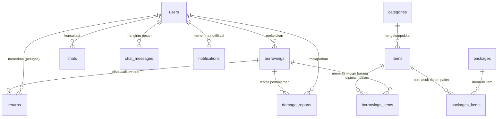

# DOKUMENTASI LENGKAP SISTEM BACKEND SARPRAS POKADA
**Real Campus Project - Facilities & Infrastructure Management System**
*Arsitektur: Enterprise Layered (Controller-Service-Repository Pattern)*
*Database: Supabase (PostgreSQL)*

---

## 1. PENDAHULUAN & RINGKASAN PROYEK

Sistem **Backend SARPRAS POKADA** dibangun sebagai fondasi server tangguh, aman, dan siap produksi (*production-ready*) untuk mengelola seluruh sirkulasi sarana dan prasarana di lingkungan kampus. Sistem ini mencakup inventarisasi aset/barang, paket peminjaman, alur persetujuan peminjaman bertingkat, pengembalian dan kalkulasi stok otomatis, pelaporan kerusakan, konsultasi langsung (chat), serta notifikasi terintegrasi.

---

## 2. TEKNOLOGI & DEPENDENSI

| Kategori | Paket / Teknologi | Fungsi & Peran dalam Sistem |
|---|---|---|
| **Core Runtime** | `Node.js (v20+)` & `Express.js (v5)` | Framework server HTTP berperforma tinggi dan asynchronous. |
| **Database & Auth** | `@supabase/supabase-js` | Client resmi PostgreSQL Supabase dengan koneksi aman dan SDK Auth. |
| **Security Layer** | `helmet` | Mengamankan HTTP Headers, anti-clickjacking, CSP, dan menyembunyikan identitas server (`X-Powered-By`). |
| **Rate Limiting** | `express-rate-limit` | Proteksi serangan **Brute-Force** pada login/register dan **Anti-DDoS/Spam** pada seluruh endpoint API. |
| **Data Validation** | `joi` | Skema validasi & sanitasi input ketat sebelum data diproses controller/database. |
| **Environment** | `dotenv` | Manajemen variabel rahasia (`.env`) agar kredensial database tidak bocor ke publik. |
| **CORS** | `cors` | Pengaturan lintas domain yang aman untuk integrasi Frontend (Next.js/React). |
| **Development** | `nodemon` | Auto-reload server saat terjadi perubahan kode pada tahap pengembangan. |

---

## 3. ARSITEKTUR STRUKTUR DIREKTORI (*ENTERPRISE LAYERED*)

```text
Sarpras_POKADA_BE/
├── config/
│   └── supabaseClient.js       # Inisialisasi client Supabase dengan sanitasi URL otomatis
├── constants/
│   ├── roles.js                # Definisi peran pengguna (Mahasiswa, Dosen, Staff, Petugas, Admin)
│   └── status.js               # Status peminjaman, kondisi barang, status laporan, dan user
├── middleware/
│   ├── authMiddleware.js       # Verifikasi token JWT Supabase & Role-Based Access Control (RBAC)
│   ├── rateLimiter.js          # Pembatasan frekuensi request (Anti-Brute Force & DDoS)
│   ├── validateRequest.js      # Middleware pemeriksa skema data Joi
│   └── errorHandler.js         # Penanganan error terpusat yang aman
├── validations/                # Skema validasi data masuk (Input Validation)
│   ├── authValidation.js       # Validasi Register & Login
│   ├── itemValidation.js       # Validasi Data Barang & Stok
│   ├── categoryValidation.js   # Validasi Kategori
│   ├── borrowingValidation.js  # Validasi Transaksi Peminjaman
│   ├── packageValidation.js    # Validasi Paket Sarpras
│   ├── returnValidation.js     # Validasi Pengembalian Barang
│   └── damageReportValidation.js# Validasi Laporan Kerusakan
├── services/                   # Business Logic Layer (Logika Inti Sistem)
│   ├── authService.js          # Logika registrasi, login, dan sinkronisasi akun
│   ├── itemService.js          # Logika inventaris, pencegahan duplikasi kode, dan stok
│   ├── categoryService.js      # Logika master data kategori dan proteksi relasi
│   ├── packageService.js       # Logika paket bundling sarpras beserta itemnya
│   ├── borrowingService.js     # Logika pinjam (auto-code PJ-xxx, cek ketersediaan stok, approval)
│   ├── returnService.js        # Logika pengembalian barang, verifikasi kondisi, pemulihan stok
│   ├── damageReportService.js  # Logika laporan kerusakan dan update kondisi barang
│   ├── chatService.js          # Logika live chat konsultasi sarpras & pesan
│   ├── notificationService.js  # Logika pengiriman & pembacaan notifikasi
│   └── userService.js          # Logika manajemen data pengguna dan profil
├── controller/                 # HTTP Orchestration Layer (Request -> Service -> Response)
│   ├── authController.js
│   ├── itemController.js
│   ├── categoryController.js
│   ├── packageController.js
│   ├── borrowingController.js
│   ├── returnController.js
│   ├── damageReportController.js
│   ├── chatController.js
│   ├── notificationController.js
│   └── userController.js
├── utils/
│   ├── appError.js             # Custom Error Class dengan HTTP status code
│   └── responseHandler.js      # Format standar respon API (`sendSuccess` & `sendError`)
├── routes/
│   ├── index.js                # Router master aggregator
│   ├── authRoutes.js
│   ├── itemRoutes.js
│   ├── categoryRoutes.js
│   ├── packageRoutes.js
│   ├── borrowingRoutes.js
│   ├── returnRoutes.js
│   ├── damageReportRoutes.js
│   ├── chatRoutes.js
│   ├── notificationRoutes.js
│   └── userRoutes.js
├── .env                        # Variabel lingkungan rahasia
├── .env.example                # Template variabel lingkungan
├── .gitignore                  # Berkas yang diabaikan dari Git
├── app.js                      # Inisialisasi Express & Konfigurasi Middleware Global
├── package.json                # Metadata dependensi proyek
└── PROJECT_DOCUMENTATION.md    # Dokumen referensi proyek
```

---

## 4. PEMETAAN TABEL DATABASE SUPABASE & RELASINYA

Sistem backend ini terhubung ke proyek Supabase: `ffvaemxzopqtsckdhdpq` dengan 10 tabel utama:



### Rincian Aturan Bisnis Relasi:
1. **`users`**: Terintegrasi langsung dengan Supabase Auth (`auth.users.id`). Menyimpan peran (*Mahasiswa, Dosen, Staff, Petugas, Admin*), status akun, dan data kontak.
2. **`items` & `categories`**: Menghapus kategori yang masih memiliki barang akan ditolak oleh sistem untuk menjaga integritas data.
3. **`borrowings` & `borrowings_items`**:
   - Sistem menghasilkan kode unik otomatis: `PJ-YYYYMMDD-XXXX`.
   - Saat peminjaman diajukan, `available_stock` pada tabel `items` langsung dikurangi sesuai jumlah yang dipinjam.
   - Jika admin menolak/membatalkan peminjaman, `available_stock` otomatis dipulihkan.
4. **`returns`**: Saat pengembalian diproses, status peminjaman diubah menjadi `'Selesai'` dan `available_stock` barang dikembalikan secara otomatis.
5. **`damage_reports`**: Jika user melaporkan kerusakan dengan `item_id`, kondisi barang otomatis diperbarui menjadi `'Rusak Ringan'` dan memicu notifikasi investigasi ke admin.

---

## 5. SISTEM KEAMANAN & AUTENTIKASI (SECURITY & RBAC)

1. **Autentikasi Token JWT**:
   - Menggunakan token bearer resmi dari Supabase Auth.
   - Validasi dilakukan di `middleware/authMiddleware.js` (`requireAuth`).
2. **Role-Based Access Control (RBAC)**:
   - Diterapkan via middleware `requireRole('Admin', 'Petugas')` untuk membatasi endpoint sensitif.
3. **Proteksi Anti Brute-Force**:
   - Endpoint login & register dibatasi maksimal **10 percobaan per 15 menit per IP**.
4. **Proteksi Anti DDoS / Flooding**:
   - Endpoint umum dibatasi maksimal **200 request per 15 menit per IP**.
5. **Sanitasi Header HTTP (Helmet)**:
   - Header `X-Powered-By` dihilangkan. Proteksi bawaan dari Clickjacking dan Cross-Site Scripting (XSS).

---

## 6. KATALOG LENGKAP ENDPOINT API

Format Base URL: `http://localhost:5000/api`

### A. Autentikasi (`/api/auth`)
| Method | Endpoint | Hak Akses | Deskripsi |
|---|---|---|---|
| `POST` | `/api/auth/register` | Publik (Rate Limited) | Registrasi akun baru + sinkronisasi ke `public.users` |
| `POST` | `/api/auth/login` | Publik (Rate Limited) | Login email & password $\rightarrow$ mengembalikan JWT access token |
| `GET` | `/api/auth/me` | User Login (Bearer JWT) | Mengambil profil user yang sedang aktif |
| `POST` | `/api/auth/logout` | User Login (Bearer JWT) | Menghapus sesi login |

### B. Master Barang / Aset Sarpras (`/api/items`)
| Method | Endpoint | Hak Akses | Deskripsi |
|---|---|---|---|
| `GET` | `/api/items` | Publik / User | Mendapatkan daftar barang (mendukung search, filter kategori, pagination) |
| `GET` | `/api/items/:id` | Publik / User | Detail lengkap satu barang beserta nama kategorinya |
| `POST` | `/api/items` | Admin / Petugas | Menambah barang baru (validasi kode unik dan stok) |
| `PUT` | `/api/items/:id` | Admin / Petugas | Memperbarui data barang, foto, atau stok |
| `DELETE` | `/api/items/:id` | Admin | Menghapus barang (dilindungi cek relasi paket & riwayat) |

### C. Master Kategori (`/api/categories`)
| Method | Endpoint | Hak Akses | Deskripsi |
|---|---|---|---|
| `GET` | `/api/categories` | Publik / User | Daftar seluruh kategori sarpras |
| `GET` | `/api/categories/:id` | Publik / User | Detail satu kategori |
| `POST` | `/api/categories` | Admin / Petugas | Menambah kategori baru |
| `PUT` | `/api/categories/:id` | Admin / Petugas | Memperbarui nama/deskripsi kategori |
| `DELETE` | `/api/categories/:id` | Admin | Menghapus kategori |

### D. Paket Sarpras (`/api/packages`)
| Method | Endpoint | Hak Akses | Deskripsi |
|---|---|---|---|
| `GET` | `/api/packages` | Publik / User | Daftar paket sarpras beserta item di dalamnya |
| `GET` | `/api/packages/:id` | Publik / User | Detail satu paket sarpras |
| `POST` | `/api/packages` | Admin / Petugas | Membuat paket bundling baru beserta daftar itemnya |
| `PUT` | `/api/packages/:id` | Admin / Petugas | Memperbarui paket dan isi itemnya |
| `DELETE` | `/api/packages/:id` | Admin | Menghapus paket |

### E. Transaksi Peminjaman (`/api/borrowings`)
| Method | Endpoint | Hak Akses | Deskripsi |
|---|---|---|---|
| `GET` | `/api/borrowings` | User / Admin | Daftar peminjaman (filter user_id, status, pagination) |
| `GET` | `/api/borrowings/:id` | User / Admin | Detail peminjaman, barang yang dipinjam, & data pengembalian |
| `POST` | `/api/borrowings` | User Login | Mengajukan peminjaman (validasi stok otomatis & auto kode PJ-xxx) |
| `PATCH` | `/api/borrowings/:id/status`| Admin / Petugas | Approval status (Disetujui, Ditolak, Selesai, dll) |

### F. Pengembalian Barang (`/api/returns`)
| Method | Endpoint | Hak Akses | Deskripsi |
|---|---|---|---|
| `GET` | `/api/returns` | Admin / User | Riwayat pengembalian barang |
| `GET` | `/api/returns/:id` | Admin / User | Detail pengembalian dan kondisi barang saat kembali |
| `POST` | `/api/returns` | Admin / Petugas | Memproses pengembalian barang dan pemulihan stok |

### G. Laporan Kerusakan (`/api/damage-reports`)
| Method | Endpoint | Hak Akses | Deskripsi |
|---|---|---|---|
| `GET` | `/api/damage-reports` | User / Admin | Daftar laporan kerusakan / kehilangan |
| `GET` | `/api/damage-reports/:id` | User / Admin | Detail satu laporan kerusakan |
| `POST` | `/api/damage-reports` | User Login | Mengirim laporan kerusakan dengan foto & deskripsi |
| `PATCH` | `/api/damage-reports/:id/status` | Admin | Update status penanganan laporan & catatan tindak lanjut |

### H. Live Chat & Konsultasi (`/api/chats`)
| Method | Endpoint | Hak Akses | Deskripsi |
|---|---|---|---|
| `GET` | `/api/chats` | User / Admin | Daftar sesi chat konsultasi |
| `POST` | `/api/chats` | User Login | Memulai ruang chat konsultasi baru |
| `GET` | `/api/chats/:chatId/messages` | User / Admin | Membaca riwayat pesan di ruang chat |
| `POST` | `/api/chats/:chatId/messages` | User / Admin | Mengirim pesan / lampiran baru |
| `PATCH` | `/api/chats/:chatId/read` | User / Admin | Menandai pesan telah dibaca |

### I. Notifikasi Sistem (`/api/notifications`)
| Method | Endpoint | Hak Akses | Deskripsi |
|---|---|---|---|
| `GET` | `/api/notifications` | User Login | Mengambil notifikasi user (disertai badge unread count) |
| `POST` | `/api/notifications` | Admin / Sistem | Memicu notifikasi manual |
| `PATCH` | `/api/notifications/:id/read` | User Login | Menandai satu notifikasi telah dibaca |
| `POST` | `/api/notifications/read-all` | User Login | Menandai seluruh notifikasi user telah dibaca |
| `DELETE`| `/api/notifications/:id` | User Login | Menghapus notifikasi |

### J. Manajemen Pengguna (`/api/users`)
| Method | Endpoint | Hak Akses | Deskripsi |
|---|---|---|---|
| `GET` | `/api/users` | Admin | Daftar seluruh pengguna terdaftar di kampus |
| `GET` | `/api/users/:id` | User / Admin | Detail profil pengguna |
| `POST` | `/api/users` | Admin / Sistem | Sinkronisasi data profil pengguna |
| `PUT` | `/api/users/:id` | User / Admin | Update profil, no_hp, foto, atau role |
| `DELETE` | `/api/users/:id` | Admin | Menghapus pengguna |

---

## 7. PANDUAN MENJALANKAN SERVER

### Mode Development (Auto-Reload):
```powershell
npm run dev
```

### Mode Production:
```powershell
npm start
```

Port Default: **`5000`** (Dapat dikonfigurasi melalui variabel `PORT` di file `.env`).
Respon console startup:
```text
Server running on port 5000
```

---

## 8. KESIAPAN INTEGRASI DENGAN FRONTEND (NEXT.JS / REACT)

Backend telah siap 100% untuk dihubungkan ke aplikasi Frontend:
1. **CORS Active**: Siap menerima request dari domain frontend (`http://localhost:3000`, Vercel, dll).
2. **Standard Respon JSON**: Semua endpoint mengembalikan format konsisten:
   ```json
   {
     "status": "success",
     "message": "Pesan status",
     "data": { ... }
   }
   ```
3. **Payload Error Terstruktur**: Jika terjadi kesalahan validasi, backend mengembalikan daftar error per field:
   ```json
   {
     "status": "fail",
     "message": "Validasi data gagal",
     "errors": [
       { "field": "email", "message": "Format email tidak valid" }
     ]
   }
   ```
4. **Header JWT Standard**: Frontend cukup menyertakan header:
   `Authorization: Bearer <access_token>` pada setiap request privat.
